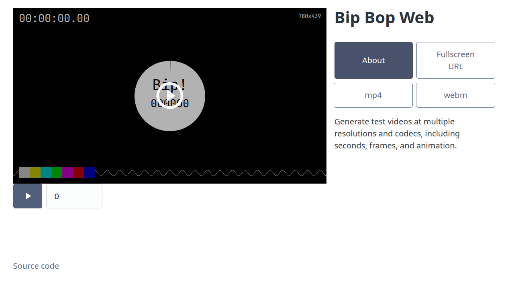
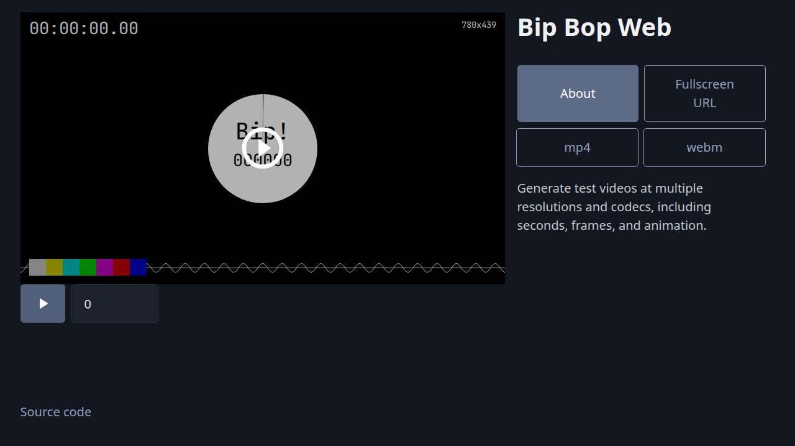

# Bip Bop Web

Generate test videos at multiple resolutions and codecs, including seconds, frames, and animation.

Try it on!: https://moko256.github.io/bip-bop-web/

## Acknowledgment

This project is inspired by:
- [Bip Bop stream (Advanced stream for tvOS - HTTP Live Streaming Examples - Apple Developer)](https://developer.apple.com/streaming/examples/advanced-stream-hevc.html)

Similar implementations:
- [DummyVideoCapturer (Sora Android SDK サンプルアプリケーション - Shiguredo)](https://github.com/shiguredo/sora-android-sdk-samples)
- [Fake Capture Device (WebRTC Load Testing Tool Zakuro - Shiguredo)](https://github.com/shiguredo/zakuro)

## License

GNU Affero General Public License v3.0 or later

`AGPL-3.0-or-later`
